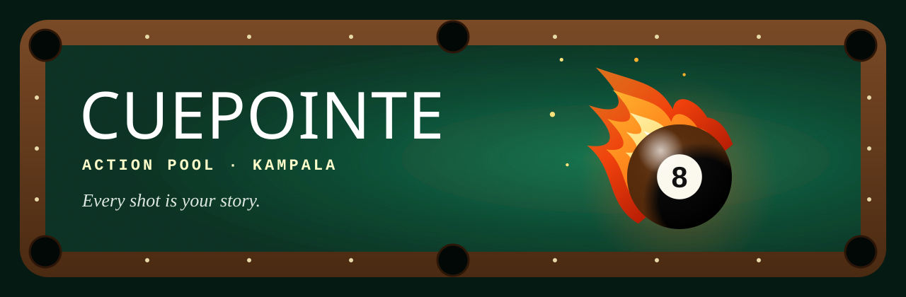

<p align="center">
  
</p>

<p align="center">
  
</p>

<p align="center">
  <a href="https://cuepointe.vercel.app"></a>
  <a href="https://cuepointe.vercel.app/register.html"></a>
  <a href="https://wa.me/256743482588"></a>
</p>

<p align="center">
  
  
  
  
</p>

---

## Rack 'em up

**CuePointe Action Pool** runs weekly pool knockouts and seasonal leagues at pool halls across Kampala.
Every match gets recorded, every player gets a public rating, and good players finally have a stage beyond their own neighbourhood.

> Started in Kabalagala, Kansanga and along Ggaba Road. Venues now rotate across the city: each event's venue is on the schedule and confirmed on WhatsApp.

---

## How a knockout night works

| | Step | What you do |
|:-:|---|---|
| **01** | **Pay the entry** | Send the entry fee shown for your event by mobile money to **0743 482 588** (Thomas Otieno). Reference: your name. |
| **02** | **Register online** | [One short form](https://cuepointe.vercel.app/register.html): name, WhatsApp, area, level, event, payment screenshot. About a minute. |
| **03** | **Show up and play** | Venue and start time come from the [schedule](https://cuepointe.vercel.app/view-schedule.html) and a WhatsApp confirmation. |
| **04** | **Climb the board** | Every result updates your rating on the [rankings](https://cuepointe.vercel.app/rankings.html). |

---

## The rating (no luck, just results)

- Everyone starts at **1000**.
- After each recorded match, the winner gains points and the loser drops the same number.
- Beat someone stronger and you gain more (up to **32**). Beat someone weaker and you gain less (at least **1**).

<details>
<summary><b>The maths, for the nerds</b></summary>

It is an Elo rating with K = 32:

```
expected = 1 / (1 + 10 ^ ((loserRating - winnerRating) / 400))
points   = max(1, round(32 × (1 − expected)))
winner  += points
loser   -= points
```

The match and both rating changes are saved together in one write, so a ranking can never be half-updated.
</details>

---

## What's on the site

| Page | What it does |
|---|---|
| [**Home**](https://cuepointe.vercel.app) | Photo slideshow, next event (only when one is really coming up), live board, schedule |
| [**Register**](https://cuepointe.vercel.app/register.html) | One-screen sign-up with the payment screenshot; the fee follows the chosen event |
| [**Schedule**](https://cuepointe.vercel.app/view-schedule.html) | Upcoming and past events with venue, entry fee and prize |
| [**Rankings**](https://cuepointe.vercel.app/rankings.html) | Player Profile cards plus the full table |
| [**News**](https://cuepointe.vercel.app/news.html) | Results and announcements |
| [**Venues**](https://cuepointe.vercel.app/venues.html) | How venues work, plus the *Host a CuePointe night* form |
| [**Talent Fund**](https://cuepointe.vercel.app/talent-fund.html) | Public ledger: every contribution and payout, totals added up automatically |
| [**About**](https://cuepointe.vercel.app/about.html) | Our story, photo gallery and partner organisations with links to their sites |
| [**Contact**](https://cuepointe.vercel.app/contact.html) | WhatsApp, phone, email and a message form |

---

## Run the show: the admin panel

Open **[cuepointe.vercel.app/admin.html](https://cuepointe.vercel.app/admin.html)** and sign in with your admin email and password.

| Tab | Use it to |
|---|---|
| **Inbox** | See every registration, message and venue application. Mark them new → contacted → confirmed / paid → archived, open payment screenshots, export CSV. |
| **Players** | Add, edit or remove players (name, area, trait, photos). |
| **Record Match** | Pick two players and the winner. Ratings, wins and events update by themselves. |
| **Schedule** | Add events with date, venue, entry fee, prize and status. Closed events drop off the homepage. |
| **News** | Publish results and announcements. |
| **Talent Fund** | Add every contribution and payout to the public ledger. |
| **About Page** | Upload gallery photos with captions; add partners with name, website and logo. |
| **Photos** | Upload any other image and copy its `media/...` path. |

Saves are live in about 10 seconds. If two people edit the same section at once, the second save is refused and the latest data reloads, so nothing gets silently overwritten.

<details>
<summary><b>First-time admin setup</b></summary>

1. In Vercel → project `cuepointe` → Settings → Environment Variables, add `ADMIN_SETUP_CODE` (type *Sensitive*, Production) with a phrase only you know, then redeploy.
2. Open the admin page. It shows **Create Admin Account**. Enter the code, your email and a password of at least 10 characters.
3. Setup locks itself once an admin exists. You can delete `ADMIN_SETUP_CODE` afterwards.
</details>

---

## Under the table: how it's built

Plain **HTML, CSS and JavaScript** pages (no framework, no build step), served by **Vercel**, with a small API in front of the database.

| Record | Lives in | Public URL |
|---|---|---|
| Registrations, messages, venue applications | Neon Postgres tables | none, admin only |
| Payment screenshots | Vercel Blob (private) | none, admin only |
| Players, matches, schedule, news, fund, about page | Neon Postgres (`documents` table) | `/players.json`, `/matches.json`, `/schedule.json`, `/news.json`, `/fund.json`, `/about.json` |
| Uploaded photos and logos | Vercel Blob | `/media/...` |

```
├── index.html, register.html, ...   pages (inner pages share one template)
├── assets/site.css, site.js         the shared look and behaviour
├── api/                             Vercel Functions (forms, data, admin)
├── lib/                             database, security and helpers
├── data/seed/                       starting data, copied into the database once
├── docs/brand/                      logo, fireball banner and icon for this README
├── tools/                           page template + artwork generators (node tools/build-pages.cjs)
└── vercel.json                      routes, security headers, caching
```

**Security, briefly:** admin passwords are hashed with scrypt and sessions live in an HttpOnly cookie. No keys or tokens are ever in the browser. Forms are validated and rate-limited, and every page ships a strict Content-Security-Policy.

**Environment variables:** `DATABASE_URL` (added by the Neon integration), `BLOB_READ_WRITE_TOKEN` (added by the Blob store), `ADMIN_SETUP_CODE` (first setup only). Never put any of them in code.

---

## Ship it

| Branch | What happens on push |
|---|---|
| `New-Test` | **Production.** Deploys to cuepointe.vercel.app in under a minute. |
| any other branch | A private preview deployment for checking changes before they go live. |
| `main` | Older copy of the site. Not deployed. |

---

## Find us

<p>
  <a href="https://wa.me/256743482588"><b>WhatsApp 0743 482 588</b></a> &nbsp;·&nbsp;
  <a href="tel:+256704100353">0704 100 353</a> &nbsp;·&nbsp;
  <a href="mailto:cuepointe@gmail.com">cuepointe@gmail.com</a>
</p>
<p>
  <a href="https://www.facebook.com/CuePointe">Facebook</a> &nbsp;·&nbsp;
  <a href="https://www.instagram.com/cuepointe">Instagram</a> &nbsp;·&nbsp;
  <a href="https://www.tiktok.com/@cuepointe">TikTok</a> &nbsp;·&nbsp;
  <a href="https://www.youtube.com/channel/UCJs5yTrm9EU0CBG6YOfU3Cw">YouTube</a> &nbsp;·&nbsp;
  <a href="https://cuepointe.blogspot.com">Blog</a>
</p>

---

<p align="center">
  <sub>© 2026 CuePointe Action Pool · Kampala, Uganda · All rights reserved.<br>
  Content, branding and media are proprietary and may not be reproduced without permission.</sub>
</p>
